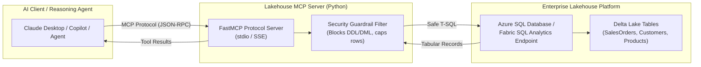

# Microsoft Lakehouse Model Context Protocol (MCP) Server

[-black)](https://modelcontextprotocol.io/)
[](https://azure.microsoft.com/)
[](https://github.com/nileshhazra/lakehouse-mcp-server)
[](https://python.org/)

An enterprise-grade **Model Context Protocol (MCP) Server** exposing **Microsoft Fabric & Azure SQL Lakehouse endpoints** as standardized tools for AI reasoning agents (Claude Desktop, VS Code Copilot, LangGraph, and Agentic RAG workflows).

Built with strict **read-only SQL guardrails** to prevent prompt injection and unauthorized schema mutations.

---

## 1. System Architecture




---

## 2. Standardized Tools Exposed to AI Agents

| Tool Name | Parameters | Description |
| :--- | :--- | :--- |
| **`list_lakehouse_tables`** | *None* | Queries database catalog (`INFORMATION_SCHEMA.TABLES`) and returns all user analytical tables. |
| **`describe_table_schema`** | `table_name: str` | Dynamically returns column names, datatypes, and nullability for a target table. |
| **`execute_analytical_query`** | `query: str` | Executes read-only analytical T-SQL queries and returns formatted JSON/tabular records. |

---

## 3. Enterprise Security & Guardrails

To prevent LLM hallucinations or prompt injection attacks from compromising production analytical data:
1. **Destructive Command Blocking:** Regex-based inspection intercepts and blocks all destructive statements (`DROP`, `DELETE`, `UPDATE`, `INSERT`, `ALTER`, `TRUNCATE`, `EXEC`).
2. **Read-Only Constraint:** Queries are strictly enforced to begin with `SELECT` or `WITH` (Common Table Expressions).
3. **Resource Safeguard:** Enforces a hard limit of 50 rows per query to prevent token explosion and client memory exhaustion.

---

## 4. Repository Structure

```text
lakehouse-mcp-server/
├── .env.example              # Database connection template
├── .gitignore                # Git exclusions
├── README.md                 # Complete documentation & Claude setup
├── requirements.txt          # MCP SDK & database drivers
└── src/
    ├── server.py             # FastMCP server with tool definitions & guardrails
    └── client_test.py        # Interactive test runner simulating AI agent queries
```

---

## 5. Quickstart

### 1. Installation
```bash
git clone https://github.com/nileshhazra/lakehouse-mcp-server.git
cd lakehouse-mcp-server
python3 -m venv .venv
source .venv/bin/activate
pip install -r requirements.txt
```

### 2. Configure Environment
```bash
cp .env.example .env
```
Update `.env` with your Azure SQL DB or Microsoft Fabric SQL endpoint credentials:
```text
DB_SERVER=sqlserver-retail-nh.database.windows.net
DB_DATABASE=sqldb-retail-source
DB_USERNAME=cloudadmin
DB_PASSWORD=YourPasswordHere
DB_PORT=1433
```

### 3. Run the Verification Test Client
```bash
PYTHONPATH=src python src/client_test.py
```

Observe the test client discover tools, inspect schemas, execute an analytical query on `SalesOrders`, and trigger the security guardrail blocking a simulated `DROP TABLE` command.

---

## 6. Connecting to Claude Desktop

To connect this Lakehouse MCP server to **Claude Desktop**, add this to your `claude_desktop_config.json`:

```json
{
  "mcpServers": {
    "lakehouse": {
      "command": "/absolute/path/to/lakehouse-mcp-server/.venv/bin/python",
      "args": ["/absolute/path/to/lakehouse-mcp-server/src/server.py"],
      "env": {
        "DB_SERVER": "your-server.database.windows.net",
        "DB_DATABASE": "sqldb-retail-source",
        "DB_USERNAME": "cloudadmin",
        "DB_PASSWORD": "your-password",
        "DB_PORT": "1433"
      }
    }
  }
}
```

Now you can ask Claude in natural language:  
*"What are the top 5 stores by order volume in our Lakehouse?"*  
Claude will autonomously invoke `describe_table_schema` and `execute_analytical_query` to return the answer!

---

## 7. Senior Interview Talking Points

> *"I designed and built an open-standard Model Context Protocol (MCP) server that connects LLM reasoning agents to our enterprise Microsoft Lakehouse endpoints. It exposes tool abstractions for dynamic table discovery and schema inspection, while enforcing strict execution guardrails that block destructive DDL/DML and protect against prompt injection. This enables natural language analytical exploration over structured Delta tables with zero human-in-the-loop overhead."*
